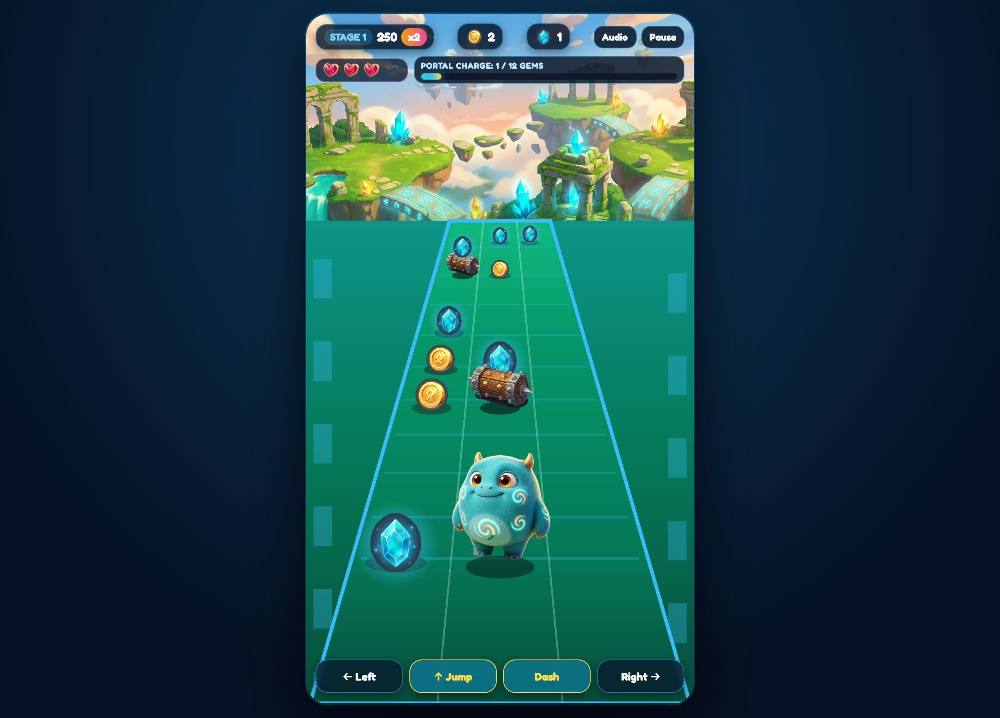

# Monster Rush: The Lost Island — Built with Google Antigravity, Nano Banana & Gemini Omni 1.2 Flash

[](https://monster-rush-lost-island-880601596687.us-central1.run.app)

- **Live Playable Game (Google Cloud Run)**: [https://monster-rush-lost-island-880601596687.us-central1.run.app](https://monster-rush-lost-island-880601596687.us-central1.run.app)
- **Interactive Developer Guide & Prompt Playbook (`/docs`)**: [https://monster-rush-lost-island-880601596687.us-central1.run.app/docs](https://monster-rush-lost-island-880601596687.us-central1.run.app/docs)
- **Full Developer Medium Article (`MEDIUM_ARTICLE.md` / `MEDIUM_ARTICLE.html`)**: [Read `MEDIUM_ARTICLE.md`](./MEDIUM_ARTICLE.md) | [View `MEDIUM_ARTICLE.html`](./MEDIUM_ARTICLE.html)



---

## Overview

**Monster Rush: The Lost Island** is a 60fps HTML5 Canvas 3-lane fantasy island runner built end-to-end with **Google Antigravity (AGY)**, showcasing how specialized AI subagents, plugins, skills, and multimodal models work together:

- **`game-dev` Plugin (`AGENTS.md`, `html5-game-engine`, `arcade-physics-and-grid-mechanics`, `game-audio-synthesizer`)**: Zero-GC `ObjectPool` memory management, High-DPI responsive `9:16` canvas, pseudo-3D runway perspective projection, and 100% procedural Web Audio synthesis.
- **`image-generator` Subagent (Nano Banana)**: Canonical 3D character design (**Bramble**), 4-panel expression poses, floating island environment, and alpha-transparent game sprites (`public/assets/`).
- **Gemini Omni 1.2 Flash (`models/gemini-omni-1.2-flash`)**: Parallel-generated 15s official launch trailer (`public/assets/monster_rush_trailer.mp4`) and in-game celebratory Stage 1 & Stage 2 completion cutscenes (`public/videos/stage1-complete.mp4` and `public/videos/stage2-complete.mp4`).
- **`modern-web-guidance` & `Google.securecoder`**: Native `<dialog>` modal, dynamic `100dvh` layout, strict Content Security Policy (CSP), and zero unsafe DOM sinks.

---

## Gemini Omni 1.2 Flash Generated Videos

| Video | Path | YouTube | Live Cloud Run Stream |
| :--- | :--- | :--- | :--- |
| **Official 15s Launch Trailer** | [`public/assets/monster_rush_trailer.mp4`](./public/assets/monster_rush_trailer.mp4) | [Watch on YouTube](https://www.youtube.com/watch?v=Fxcztban6uY) | [Stream MP4](https://monster-rush-lost-island-880601596687.us-central1.run.app/public/assets/monster_rush_trailer.mp4) |
| **Stage 1 Complete Cutscene** (*"Great job! You completed Stage 1!"*) | [`public/videos/stage1-complete.mp4`](./public/videos/stage1-complete.mp4) | [Watch on YouTube](https://www.youtube.com/watch?v=7MsWvDHVNJ8) | [Stream MP4](https://monster-rush-lost-island-880601596687.us-central1.run.app/public/videos/stage1-complete.mp4) |
| **Stage 2 Complete Cutscene** (*"Great job! You passed Stage 2! Let's go to Stage 3!"*) | [`public/videos/stage2-complete.mp4`](./public/videos/stage2-complete.mp4) | [Watch on YouTube](https://www.youtube.com/watch?v=jwcN5bDZ25c) | [Stream MP4](https://monster-rush-lost-island-880601596687.us-central1.run.app/public/videos/stage2-complete.mp4) |
| **World Reveal Cinematic** | [`public/videos/stage1-world-reveal.mp4`](./public/videos/stage1-world-reveal.mp4) | [Watch on YouTube](https://www.youtube.com/watch?v=-k505d3_3uw) | [Stream MP4](https://monster-rush-lost-island-880601596687.us-central1.run.app/public/videos/stage1-world-reveal.mp4) |
| **Meet the Hero Cinematic** | [`public/videos/stage2-meet-the-hero.mp4`](./public/videos/stage2-meet-the-hero.mp4) | [Watch on YouTube](https://www.youtube.com/watch?v=ddCzs-cTFWs) | [Stream MP4](https://monster-rush-lost-island-880601596687.us-central1.run.app/public/videos/stage2-meet-the-hero.mp4) |

---

## Run Locally & Test

```bash
# Start local HTTP server
python3 -m http.server 8765 --bind 127.0.0.1

# Open http://127.0.0.1:8765/index.html

# Run automated unit & security tests
node --test tests/game.test.mjs
```

## Deploy to Google Cloud Run

```bash
gcloud run deploy monster-rush-lost-island \
  --source . \
  --region us-central1 \
  --allow-unauthenticated
```
